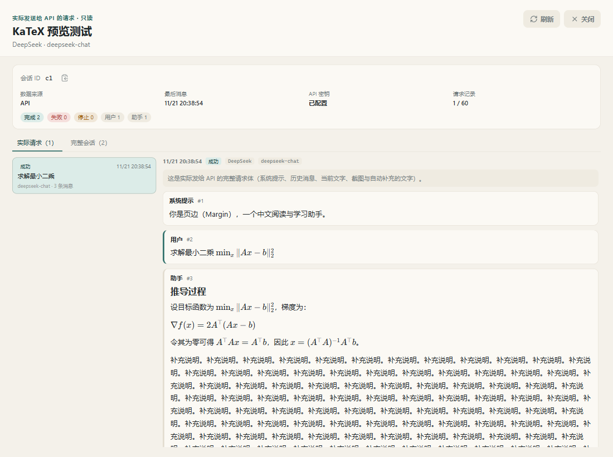
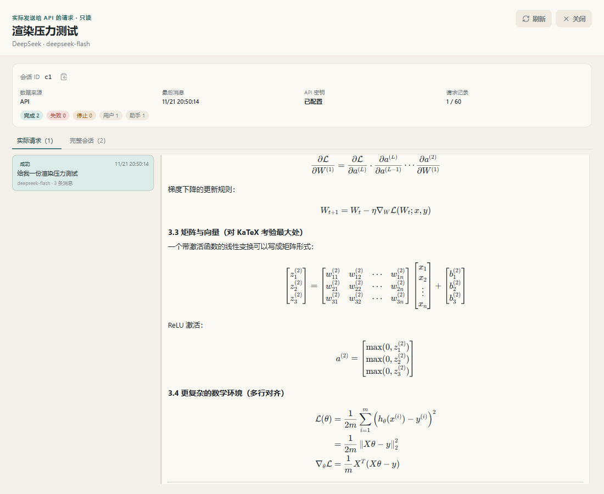
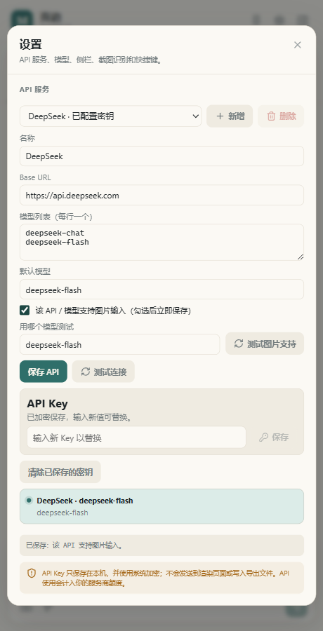
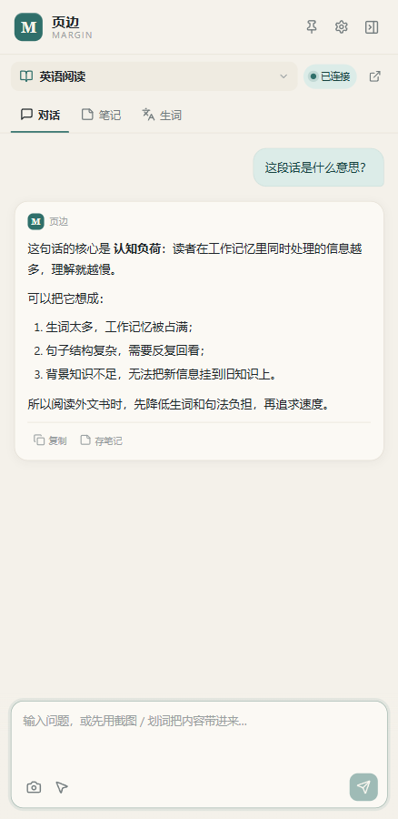
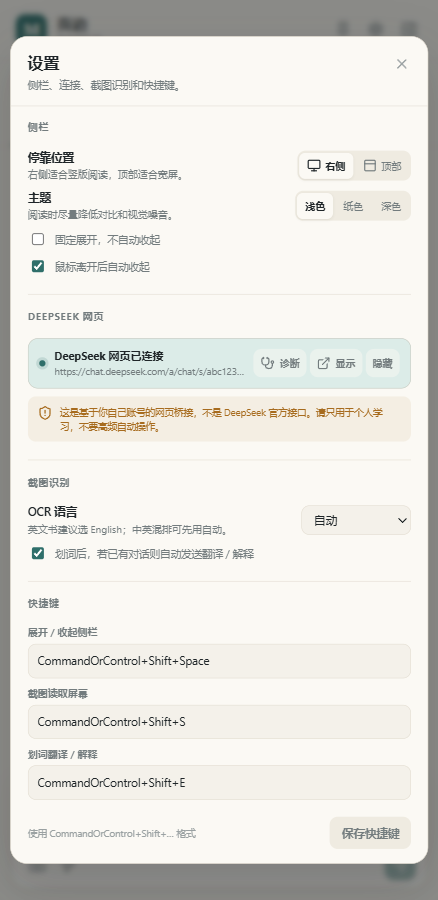
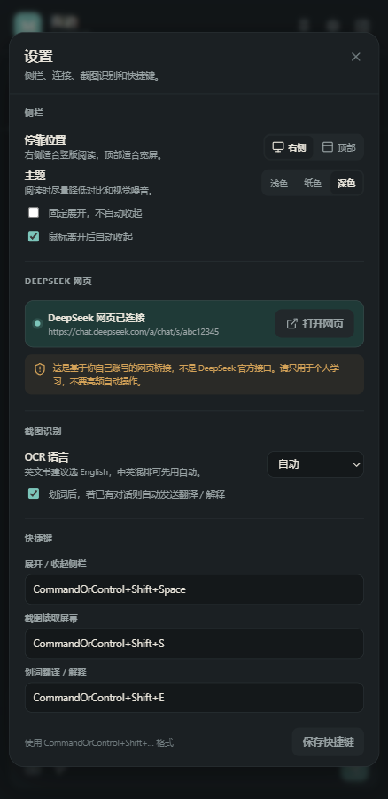

# 页边 Margin 0.2.9

Windows 阅读伴读侧栏。把 **API 对话**、截图提问、文献笔记、生词本和全局划词解释收进一个贴边工具里，不打断阅读。

0.2.0 彻底移除了 DeepSeek 网页桥接，改用可配置的 API 对话；0.2.1 新增只读的会话查看窗口；0.2.2 修正用户消息的发送状态；0.2.3 让查看窗口展示**实际发送给 API 的完整请求**。

## 已实现

- **右侧 / 顶部贴边侧栏**：置顶、无边框、可收起成细条、鼠标悬停展开、固定展开、全局快捷键切换；托盘菜单可随时找回。
- **API 对话**：
  - 支持 DeepSeek 官方 API 和任意 OpenAI-compatible API。
  - 可添加多个 API 服务，分别配置 Base URL、模型列表、默认模型和是否支持图片输入。
  - 每个文献项目固定使用一条本地 API 会话，英语阅读共用一条。发送新消息不会新建会话。
  - API 是无状态的，每次请求由 Margin 从本地 SQLite 读取该项目的历史消息并发送，因此重启、切换项目、切换模型后对话仍然连续。
  - 模型选择可在标题栏或设置中切换；切换模型不会丢失历史。
- **实际请求查看窗口（0.2.3 起）**：标题栏的眼睛按钮打开独立只读窗口，展示**真实发送给 API 的请求内容**：
  - 每次请求左侧列出时间、结果（成功 / 失败 / 已停止）、模型和是否含图片；
  - 右侧以 Markdown / KaTeX 渲染完整请求体：系统提示、历史消息、当前用户文字、自动附加的屏幕上下文与 OCR 文字、图片部分；
  - 图片按 `[图片类型，大小]` 标注，并可查看本地存档的原图；
  - 显示记录字数与实际发送字数的差异，说明哪些补充文字被加进了请求；
  - 显示上下文裁剪情况（本地历史条数 → 实际发送条数，以及上限）；
  - 失败请求会显示错误信息与错误码；
  - 打开后自动滚动到底部，最新内容优先可见。
  - “完整会话”标签仍可查看本地数据库中的全部消息。
- **请求记录**：每次 API 调用（包括摘抄）都会在 `userData/request-logs/` 写入一份 JSON，附带图片存档；查看窗口展示最近 60 次。
- **消息状态**：用户消息在请求开始前记为“发送中”，请求成功后标记完成；失败时如果已经收到内容则保留为完成，否则标为失败。
- **旧对话迁移**：首次启动 0.2.0 时，会先通过 SQLite `VACUUM INTO` 生成 `margin.db.pre-0.2.0.bak` 备份，然后为每个现有项目创建本地 API 会话，并把旧版保存的完整消息历史关联进去。旧网页对话的 URL / ID 只作为迁移来源保留，不再被调用。
- **API Key 安全存储**：API Key 使用 Electron `safeStorage`（Windows DPAPI）加密保存在本机，渲染进程只能看到“已配置 / 未配置”，导出数据不包含密钥。
- **截图提问**：框选区域 → 附加图片 → 发送。若当前 API 标记为支持图片，会按多模态内容发送；否则自动用 Windows 本地 OCR 识别成文字后发送，并在设置里选择 OCR 语言。
- **自动屏幕上下文**：每次提问前可自动截取完整屏幕；模型支持图片时附带原图，否则使用 OCR 文字。可在设置里关闭。
- **深度思考**：支持 API 返回的 `reasoning_content` 流，思考过程与最终回答分开，折叠展示，不进入回答正文、复制、笔记或生词。
- **对话**：流式输出、停止生成、Markdown / 表格 / 代码 / KaTeX 渲染、复制、存笔记、存生词。
- **公式渲染**：继续支持 `$...$`、`$$...$$`、`\(...\)`、`\[...\]`、以及缺少定界符的独立 LaTeX 行；代码块中的反斜杠不会被误转换。
- **生词自动填充**：划词翻译 / 解释时，模型会在回答末尾输出隐藏的 `[VOCAB]` 块；回答下方“存生词”会自动填入单词、音标、释义和例句。
- **笔记 / 生词本**：共享的嵌套文件夹树、笔记类型、Markdown / KaTeX 阅读视图、复习次数。
- **全局划词**：任意应用选中文字后按 `Ctrl+Shift+E`，在鼠标旁弹出“翻译 / 解释 / 摘抄 / 存生词”。
- **主题**：浅色、纸色、深色。
- **数据**：SQLite 本地存储，支持一键导出 JSON 备份（不含 API Key）。

## 界面







| 对话 | 设置 | 深色 |
| --- | --- | --- |
|  |  |  |

## 快速开始

要求：Windows 10/11、Node.js 20+、npm。

```powershell
cd margin
npm install
npm run dev
```

如果 Electron 运行时没有下载成功（国内网络常见），可以使用镜像：

```powershell
$env:ELECTRON_MIRROR = "https://npmmirror.com/mirrors/electron/"
node node_modules/electron/install.js
```

构建前端和主进程：

```powershell
npm run build
```

打包 Windows 安装包：

```powershell
npm run dist
```

生成的安装包在 `release/` 下。未签名的安装包会触发 SmartScreen 提示，这是正常现象；正式分发需要代码签名证书。

## 首次使用

1. 启动后点击标题栏的“未配置 API”或右上角设置。
2. 在“API 服务”中选择 `DeepSeek`，或新增一个 OpenAI-compatible API。
3. 填写 Base URL（DeepSeek 默认 `https://api.deepseek.com`）和 API Key，点击“保存 API”与“测试连接”。
4. 确认模型列表和默认模型。DeepSeek 默认提供 `deepseek-chat` / `deepseek-reasoner`。
5. 回到对话，选择项目，发送第一条消息。项目会自动使用已有的本地对话历史。
6. 点击标题栏的眼睛按钮，打开“实际请求”窗口，核对每次发送的完整内容。
7. 选择屏幕区域：`Ctrl+Shift+S`；划词：`Ctrl+Shift+E`；展开 / 收起：`Ctrl+Shift+Space`。

快捷键可以在设置里修改，格式为 Electron accelerator，例如 `CommandOrControl+Shift+S`。

## 侧边工具栏

- 左侧工具栏依次提供设置、固定展开、待办事项和会话列表，底部是余额与额度。会话列表支持滚动、切换、新建和删除。上方的模型菜单按提供商分组，选择任一模型即可切换服务。
- 待办清单在各项目间共用，支持新增、编辑、完成和删除。内容保存在本地 SQLite，并随 JSON 导出。
- DeepSeek 查询官方账户余额，并按北京时间统计 Margin 今日收到的用量回执。面板显示 Token 数，可打开 DeepSeek 账单查看全账号金额。
- ChatGPT 面板可按需从已登录的本机 Codex CLI 读取 5 小时和 1 周剩余额度。核对 Codex 与 Margin 使用的账号和工作区，或打开 ChatGPT 用量页面查看订阅额度。

## ChatGPT 订阅和联网搜索

- 在设置中点 **Continue with ChatGPT**，在系统浏览器完成授权。Margin 读取账号可用的模型，使用 ChatGPT 订阅额度。授权凭据经系统加密保存在本机。
- 使用普通 API Key 时，可在设置中选择 **添加 OpenAI Responses API**。两种通道均可在当前项目中切换模型，沿用本地文本历史。Margin 对话不会写入 ChatGPT 客户端的聊天列表。
- 使用上述通道时，在发送前勾选 **联网搜索**。该开关在成功发送后重置，模型须支持搜索且账号或工作区须允许使用。回答会显示 API 返回的来源链接，请求查看窗口会标记已启用搜索。DeepSeek 官方服务也可启用原生联网，由模型决定本轮是否调用。自定义 Chat Completions 沿用普通对话。

## API 能力与限制

- **上下文**：API 请求由 Margin 构造，保留最近 60 条消息，并按用户 / 助手成对裁剪，总长度超过约 7 万字符时从最旧的一对开始丢弃；实际发送内容可在查看窗口逐条核对。
- **图片**：官方 DeepSeek 文本模型通常不支持图片输入，因此默认 `supportsVision = false`，截图会走本地 OCR，并把 OCR 文字追加到请求正文中；这一补充文字会完整显示在查看窗口里。
  - 模型支持图片时（勾选或“测试图片支持”通过），只发送原图，不再追加 OCR 文字，避免同一内容重复发送。
  - 在设置里勾选“支持图片输入”会立即保存。
  - 不确定时点“测试图片支持”：应用会向该模型发一张 1×1 图片，能正常返回即判定支持，返回不支持图片的错误即判定不支持，并把结果写回配置。
- **模型能力差异**：`supportsVision` 目前是服务级开关；同一服务下不同模型能力不一致时，请分别建立 API 配置。
- **历史图片**：新旧本地消息只保存文本；只有 0.2.3 之后的请求会在 `request-logs/` 里保留当时的图片存档。
- **网页历史**：迁移的是 Margin 本地数据库中的消息，不是 DeepSeek 网页服务器上的完整会话。
- **旧版网页绑定**：旧版本的 `conversation_bindings` 数据只用于标记“迁移自网页”，不会再被调用，也不会自动删除。

## 数据与隐私

- 数据保存在 Electron 的 `userData` 目录下的 `margin.db`（SQLite）。
- 请求记录保存在 `userData/request-logs/`，包含请求文字与截图存档；这些文件是本机数据，导出 JSON 不包含它们。
- API Key 保存在 `userData/api-credentials.json`，只保存 `safeStorage` 加密后的密文。
- API 请求会把当前项目的历史消息、输入文字，以及（在开启时）截图 / OCR 文字发送到你配置的 API 服务商；这些内容会离开本机，并按服务商规则保留。
- 如不想发送屏幕内容，请关闭“自动读取当前屏幕”，并不要使用截图按钮。

## 开发

```text
src/
  main/                Electron 主进程
    index.ts           IPC、生命周期、快捷键、API 对话编排、查看窗口
    apiClient.ts       OpenAI-compatible / DeepSeek 流式请求与 SSE 解析
    apiCredentials.ts  safeStorage 加密 API Key
    requestLog.ts      请求构造、上下文裁剪、请求记录读写
    database.ts        SQLite、项目、会话、消息、笔记、生词
    capture.ts         截图、OCR、屏幕上下文
    selection.ts       全局划词
    windowManager.ts   贴边窗口、收起 / 展开
  preload/             contextBridge（index / overlay / toolbar）
  renderer/            React 界面（含 InspectorPage 请求查看窗口）
  shared/              类型、API 契约、Markdown / 公式 / 生词工具
```

## 更新日志

### 0.2.9

- 新增左侧工具栏和可滚动的会话面板，设置、固定展开、待办和额度入口迁入工具栏。
- 新增 SQLite 本地待办清单，支持新增、编辑、完成和删除。
- 顶部模型菜单按提供商分组，可直接切换模型及服务。
- 支持查询 DeepSeek 账户余额与 Margin 今日 Token 用量，通过本机 Codex 读取 5 小时和 1 周额度。

### 0.2.8

- DeepSeek 官方 API 支持原生联网，设置中可单独刷新模型列表和测试联网。
- 隔离各项目的生成与停止状态，切换时保留输入和截图，发送失败后可直接重试。
- 修复 API 密钥并发写入、上下文裁剪和兼容接口流式错误处理。

### 0.2.7

- 支持使用 ChatGPT 账号授权，按账号可用模型切换，沿用项目的本地会话。
- 支持 OpenAI Responses API，并可按轮启用联网搜索和查看来源链接。

### 0.2.6

- 修复公式归一化把正文、标题、引用、表格和代码误判成公式的问题（上一版请求预览里 Markdown 几乎全部失效）。
- 公式处理改为“先保护、后改写”：行内代码、代码块、已有的 `$...$` 不再被反斜杠规则破坏。
- `\(...\)`、`\[...\]`、`\begin{equation}` 归一化，以及对裸 LaTeX 行的自动包裹，均跳过标题 / 列表 / 引用 / 表格 / 中文正文。
- 新增 `npm run test:math` 回归测试，并在发布工作流中执行。

### 0.2.5

- 实际请求窗口改用 KaTeX 渲染：公式、标题、列表、表格、代码块按 Markdown 正常排版。
- 模型支持图片时只发送原图，不再额外追加 OCR 文字；OCR 仅用于不支持图片的模型。
- 实际请求窗口加载后自动滚动到底部，先看到最新内容；“完整会话”标签同样默认到底部。
- 支持自动屏幕上下文时，视觉模型只发送截图，不再附加屏幕 OCR 文字。

### 0.2.4

- 修复“支持图片输入”复选框勾选后退出设置又恢复未勾选的问题：勾选会立即保存。
- 新增“测试图片支持”：发送一张 1×1 测试图，由 API 返回结果判断该模型是否真正接受图片输入，并可一键把探测结果写入配置。
- 表单修改后“保存 API”按钮会提示存在未保存的修改。

### 0.2.3

- 查看窗口改为展示实际发送给 API 的完整请求，包括系统提示、历史、屏幕上下文、OCR 文字和图片部分。
- 新增请求记录 `request-logs/`（JSON + 图片存档），查看窗口展示最近 60 次请求。
- 图片在请求中以 `[图片类型，大小]` 标注，并可查看存档原图。
- 上下文裁剪改为按用户 / 助手成对裁剪，避免出现孤立回答。
- 摘抄请求同样写入请求记录。

### 0.2.2

- 用户消息先记为“发送中”，请求结束后再标记完成或失败。
- 会话查看窗口在发送结束后自动刷新。

### 0.2.1

- 新增标题栏“本地真实会话”眼睛按钮与只读会话窗口。

### 0.2.0

- 移除 DeepSeek 网页桥接，改为 API 对话。
- 新增多 API、模型选择、API Key 加密存储和旧消息迁移。
