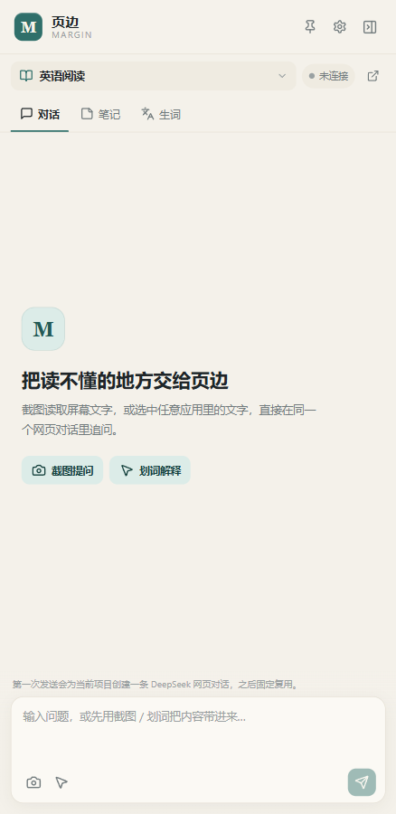
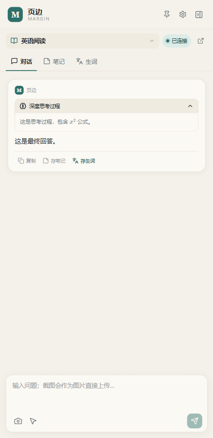
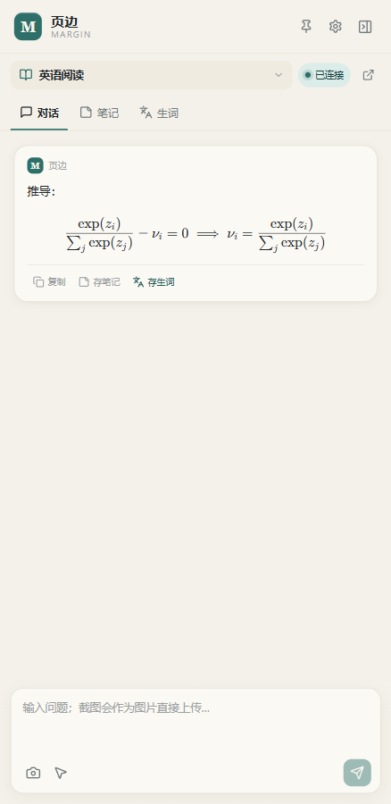
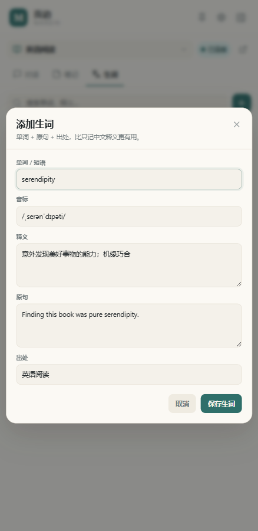
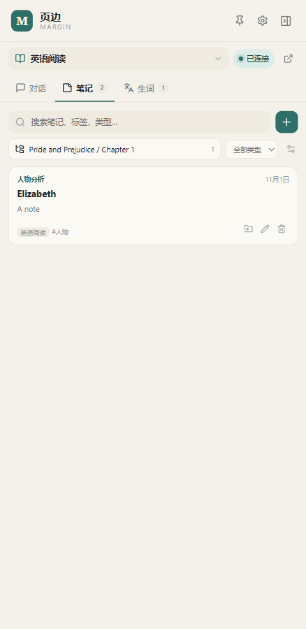
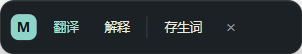
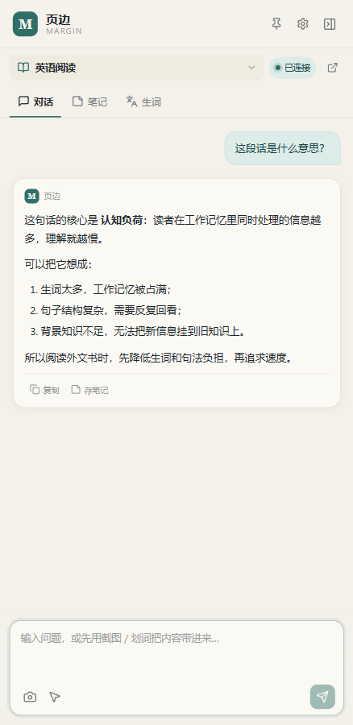
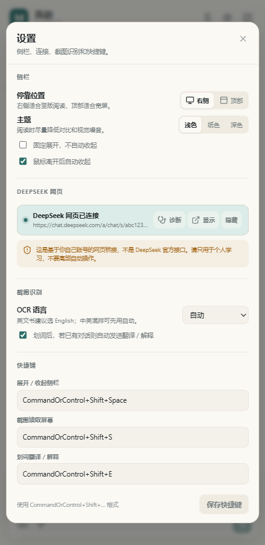
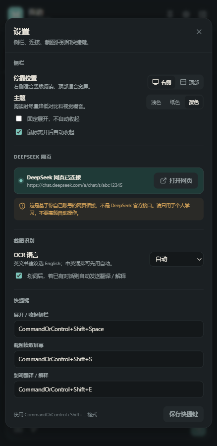
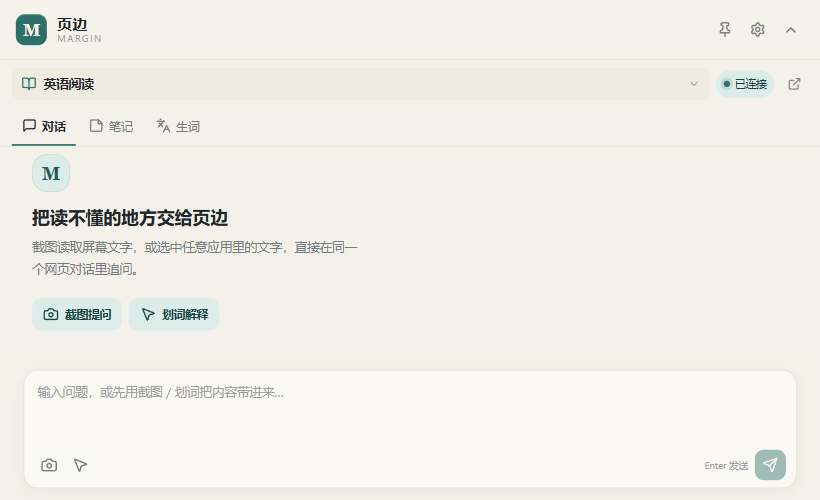

# 页边 Margin

Windows 阅读伴读侧栏。把 DeepSeek 网页对话、截图提问、文献笔记、生词本和全局划词解释收进一个贴边工具里，不打断阅读。



## 已实现

- **右侧 / 顶部贴边侧栏**：置顶、无边框、可收起成细条、鼠标悬停展开、固定展开、全局快捷键切换；托盘菜单可随时找回。
- **DeepSeek 网页对话**：
  - 使用持久化 WebView 会话，登录状态会保留。
  - 每个文献项目绑定一条网页对话 URL / 会话 ID；英语阅读共用一个对话。
  - 启动后恢复上次项目与对话；发送前校验 URL，发现不一致会停止，不会静默新开。
- 删除项目前会先统计并确认该项目下的笔记、生词和对话消息数量；确认后才级联删除本地数据，网页端对话不受影响。
  - 网页面板可显示、可隐藏，用于登录、验证码、页面改版后的手动兜底。
- **截图提问**：框选区域 → 截取区域作为图片附加到输入框 → 发送时直接上传到 DeepSeek 网页对话。不再对框选区域做 OCR，也不把识别文字塞进输入框；输入框上方会显示一张缩略图，可移除。
- **自动屏幕上下文（0.1.1 起，0.1.4 改为优先原图，0.1.6 改为完整屏幕）**：每次提问前短暂隐藏页边窗口，截取包含被遮挡区域在内的整个屏幕，优先把原图直接附加到 DeepSeek 网页对话；如果网页没有接受图片，才回退为 OCR 文字。所以可以直接问“这一页讲的是什么”。可在设置里关闭。本地临时图片在识别 / 上传后立即删除，不显示截图提示。
- **深度思考**：打开 DeepSeek 网页的深度思考后，思考过程会与最终回答分开读取，在回答上方以“深度思考过程”默认折叠展示；点击可以展开查看，思考内容不会混进回答正文、复制、存笔记或存生词。


- **对话**：流式读取网页回答、停止生成、Markdown / 表格 / 代码 / KaTeX 渲染、复制、存笔记、存生词。网页选择器读不到回答时，会自动用页面文本差异回退；回退范围限制在主聊天区，并排除左侧会话列表，避免把会话名称当成回答。仍然失败时，错误卡片提供“尝试读取网页最后一条回答”和“打开网页面板确认”。
- **公式渲染**：从 KaTeX 的 `annotation[encoding="application/x-tex"]` 还原原始 TeX，避免读到隐藏 MathML 里的 Unicode 乱码（如 `𝜆`、`𝑖`）；再兼容 `$...$`、`$$...$$`、`\(...\)`、`\[...\]`、多重转义反斜杠和 `equation` / `align` / `gather` 环境。对于缺少定界符、甚至只剩一个尾部 `]` 的独立 LaTeX 行（如 `\frac{...}{...} - \nu_i = 0 ... ]`、`\langle \nabla f(x), ... \rangle \ge ... ]`、以 `= \mu ...` 开头的续行），会自动去掉多余括号并包成 `$$...$$`。识别基于 LaTeX 语法密度，而不是命令白名单：`\` 命令、上下标、花括号、关系符、`\|...\|` 范数、以 `=` / `+` / `-` / `(` / `&` 开头的续行都会参与判断；`\documentclass`、`\usepackage` 等导言区代码会排除。对于 DeepSeek 原文丢失 `*` 后形成的 `(f^)^(y)`，会先修复为 `(f^{*})^{*}(y)` 再渲染；KaTeX 的错误颜色也改成正文色，避免整段公式被标红。归一化后交给 KaTeX，并用 `renderMathInElement` 对残留公式做兜底解析。代码块里的反斜杠不会被误转换。


- **生词自动填充**：划词翻译 / 解释时，提示词会要求模型在回答末尾输出隐藏的 `[VOCAB]` 块（word / phonetic / meaning / example）。回答下方的“存生词”会解析这个块，自动填好单词、音标、释义、例句和出处；模型没按格式输出时，会用关键词和回答内容尽力补全，保存前仍可手动修改。


- **笔记**：所有会话共享一个笔记库，使用独立的嵌套文件夹树（书名 → 章节 → 小节）。一条笔记只属于一个文件夹，可移动到任意文件夹；已有文献笔记 / 概念卡片等“类型”，用户也可以新增自定义类型。点卡片进入阅读视图，正文按 Markdown / KaTeX 渲染；编辑弹窗里有“编辑 / 预览”切换。
- **生词本**：所有会话共享一个生词库，使用与笔记**分开的**嵌套文件夹树。单词、音标、释义、原句、出处、复习次数；生词可以单独移动到目标文件夹。


- **全局划词**：在任意应用选中文字后按 `Ctrl+Shift+E`，在鼠标旁弹出“翻译 / 解释 / 存生词”。已有对话且开启自动发送时，翻译 / 解释会直接进入当前对话。


- **主题**：浅色、纸色、深色；设置会保存在本地。
- **数据**：SQLite 本地存储，支持一键导出 JSON 备份。

## 界面

| 对话 | 设置 | 深色 |
| --- | --- | --- |
|  |  |  |

顶部模式：



## 快速开始

要求：Windows 10/11、Node.js 20+、npm。

```powershell
cd margin
npm install
npm run dev
```

如果 Electron 运行时没有下载成功（国内网络常见），可以使用镜像：

```powershell
$env:ELECTRON_MIRROR = "https://npmmirror.com/mirrors/electron/"
node node_modules/electron/install.js
```

然后再次运行 `npm run dev`。

构建前端和主进程：

```powershell
npm run build
```

打包 Windows 安装包：

```powershell
npm run dist
```

生成的安装包在 `release/` 下。未签名的安装包会触发 SmartScreen 提示，这是正常现象；正式分发需要代码签名证书。

## 首次使用

1. 启动后点击右上角外链图标，或项目面板里的“打开网页”。
2. 在 DeepSeek 网页面板里登录自己的账号。应用不会保存密码、不导出 Cookie。
3. 在“英语阅读”或新建的文献项目里发送第一条消息。应用会创建一条网页对话，并捕获 URL 中的会话 ID。
4. 之后这个项目会固定复用同一条对话。也可以粘贴已有 DeepSeek 对话链接进行绑定。
5. 默认每次提问都会自动截取完整屏幕并优先附加原图；所以可以直接问“这一页讲的是什么”。可在设置里关闭。手动框选截图同样直接附加图片，不走 OCR。
6. 选择屏幕区域：`Ctrl+Shift+S`；划词：`Ctrl+Shift+E`；展开 / 收起：`Ctrl+Shift+Space`。

快捷键可以在设置里修改，格式为 Electron accelerator，例如 `CommandOrControl+Shift+S`。

## DeepSeek 网页桥接说明

这是基于你自己账号的**非官方网页桥接**，不是 DeepSeek 官方 API：

- 登录态保存在独立的持久化 WebView 分区中。
- 应用只访问 `chat.deepseek.com`，不保存密码，不绕过验证码。
- 对话通过 URL 中的会话 ID 绑定，而不是通过对话标题。
- 发送前会校验当前网页 URL 是否仍是绑定的对话；不一致就停止。
- 网页 DOM 结构、登录流程或风控策略变化时，自动收发可能失效；此时可以打开网页面板手动操作。
- 请只用于个人学习，不要高频自动操作或多账号批量使用；商业化前请先做平台条款与法律评估。

## 数据与隐私

- 数据保存在 Electron 的 `userData` 目录下的 `margin.db`（SQLite）。
- 手动框选截图不再写临时文件，也不做 OCR；图片只存在于内存和当前待发送附件中，发送后从界面移除。
- 自动屏幕上下文会为 OCR 回退写临时图片，OCR / 上传完成后立即删除；应用启动时也会清理残留。
- 原图会尝试上传到你自己的 DeepSeek 网页对话；自动模式的回退文字也可能进入对话，因此会离开本机。上传到 DeepSeek 服务器后的副本不受本应用控制，会按你的账号和平台规则保留。
- 如果不想发送屏幕图片，请在设置里关闭“自动读取当前屏幕”，并且不要使用截图按钮。
- “导出数据”包含项目、对话镜像、笔记、生词、文件夹树和笔记类型，不包含截图。
- 笔记、对话镜像和深度思考过程保存在本地 SQLite 中；需要更强保护时可以配合 BitLocker 等系统级磁盘加密。

## 开发

```text
src/
  main/                Electron 主进程
    index.ts           IPC、生命周期、快捷键
    windowManager.ts   贴边窗口、收起/展开
    deepseekBridge.ts  DeepSeek 网页窗口与会话绑定
    capture.ts         区域截图、OCR、临时文件清理
    selection.ts       全局划词与浮条
    database.ts        SQLite 数据层
  preload/
    index.ts           主窗口 IPC API
    deepseek.ts        注入 DeepSeek 网页的 DOM 桥接
    overlay.ts         截图选择层
    toolbar.ts         划词浮条
  renderer/            React 界面
  shared/              类型、URL 解析
resources/
  ocr.ps1              Windows.Media.Ocr 调用
  read-selection.ps1   UI Automation 读取选区
  copy-selection.ps1   Ctrl+C 兜底读取选区
```

常用命令：

```powershell
npm run typecheck
npm run build
npm run dev
```

调试时可以使用：

```powershell
$env:MARGIN_DEBUG = "1"
$env:MARGIN_DEBUG_PORT = "9223"
npm run dev
```

`MARGIN_DEBUG=1` 会在项目根目录写 `margin-debug.log`；`MARGIN_DEBUG_PORT` 会打开 Chromium 远程调试端口。

## 已知限制

- **网页桥接依赖 DeepSeek 当前页面结构**。`src/preload/deepseek.ts` 中的输入框、发送按钮和 `.ds-markdown` 选择器是启发式的；DeepSeek 改版后可能需要更新。网页面板始终保留手动兜底。
- **回答读取有回退**：优先读新增的 `.ds-markdown` 块；如果网页没有已知回答容器，才使用“当前问题之后”的文本回退，避免把上一轮回答和用户问题带进来。流式结束判断从 3.5 秒放宽到 6 秒，减少长回答被提前截断。仍然失败时用错误卡片里的“尝试读取网页最后一条回答”。
- **生词格式是“请求模型遵守”的约定**，不是强制 API。模型偶尔会漏掉 `[VOCAB]` 块或改写字段；此时应用会用关键词和回答做启发式补全，保存前请检查并修改。
- **深度思考过程依赖 DeepSeek 当前 DOM**。应用会识别 `think` / `reason` 类容器，或“已深度思考 / 思考中”标题所在的折叠面板，并排除发送前已存在的旧容器；如果网页改版导致识别不到，思考内容会退回为普通回答的一部分。此时打开设置 → DeepSeek 网页 → 诊断，查看 `reasoningRoots` 和 `reasoningPreview`。
- **图片上传依赖 DeepSeek 网页当前的图片上传 / 粘贴能力**。应用只会执行一种上传路径（优先文件输入，没有文件输入时才模拟粘贴），避免同一张图被上传两次；如果网页不接受图片，会自动模式会改用 OCR 文字并提示“网页没有接受原图”，手动框选截图则只会发送问题文字。原图上传对图表、公式、双栏排版更友好，但仍然可能受网页风控或版本变化影响。自动模式会短暂隐藏页边窗口，截取整个屏幕，可在设置里关闭。
- **OCR 语言**：默认使用系统用户语言；英文书建议在设置里选 `English`，中文选 `简体中文`。
- **Windows 专用**：使用 Windows OCR、Windows 剪贴板和 Windows 窗口行为。
- **网页登录 / 验证码** 需要用户自己在网页面板完成，无法自动化。
- 0.1.27 修复切换/重启后首轮回答串入上一轮：流式读取现在先定位当前用户消息，只接受它之后的回答块，避免新页面历史加载后把上一轮回答当成“本轮新增”；完整回读同样从当前问题之后取。网页窗口改为 1% 透明确保可见、鼠标穿透、任务栏隐藏，并在启动时预热网页，减少首轮依赖手动打开。已验证“旧回答 + 当前问题 + 本轮回答”只输出本轮内容。
- 0.1.26 会话分页与渲染性能：数据库按 50 条消息分页，启动/切换项目只加载最新 50 条；顶部“加载更早的消息”用时间+ID 游标加载上一页，加载后保持滚动位置。消息行和 Markdown 组件改为 memo，避免输入框变化/流式输出时全量重渲染；自动跟随只在用户接近底部时发生，加载历史时不再强行滚到底部。已验证 120 条消息的三页分页、去重、顺序和加载位置保持。
- 0.1.25 代码块增加可用工具栏：复制使用系统剪贴板，下载弹出保存对话框；工具栏在代码块内 sticky，长代码内部滚动或页面滚动时仍停留在代码上方。提取时会清理网页自带的“复制/下载”按钮文字，避免它们作为正文出现。已用 40 行代码测试复制内容、下载文件名/内容和 sticky 布局。
- 0.1.24 修复代码块不显示：回答块筛选写反了“保留最外层还是最内层”，当同时选中 `pre`/`code` 时保留了内层 `code`，于是代码变成单行反引号甚至被丢掉。现在保留最外层回答块，`<pre><code>` 会完整序列化为三反引号代码块；同时把独立代码块/高亮容器纳入回答读取。已验证代码在 `.ds-markdown` 内、外两种结构。
- 0.1.23 继续修复首条消息必须打开网页才显示：DeepSeek 页面此前放在 `show: false` 的窗口里，页面可能认为自身不可见，从而延迟首轮 DOM/懒加载渲染；打开网页面板后才真正可见。现在隐藏时不再调用 `hide()`，而是保留一个透明、不可聚焦、任务栏隐藏但已显示的窗口，让页面持续处于可见和已布局状态；打开面板时恢复可见。仍保留 60 秒等待与完整回读兜底。
- 0.1.22 修复换对话后的首条消息读取失败：首轮回答偶尔超过 25 秒才出现，旧逻辑会在网页仍在生成时提前报错。现在检测到停止生成按钮时继续等待，首次无响应的宽限从 25 秒延长到 60 秒，并保留完整回答恢复。设置新增“开机时自动启动 Margin”，写入 Windows 登录项。
- 0.1.21 修复 Emoji 标题与后续正文/公式丢失：Emoji 在网页 DOM 中常是 `` 或 `aria-label` 节点，原先没有文本就被忽略；标题也可能不是 `<h1>/<h2>`，而是由字号/字重模拟的 `<div>/<span>`。现在会读取图片 `alt` 和无文本节点的 `aria-label`/`title`，并根据计算后的字号、字重把视觉标题序列化为 `#`/`##`。已用“Emoji 图片标题 + 粗体 + 公式 + 列表”的 DOM 测试验证。
- 0.1.20 修复首次发送/刚打开旧对话时读不到回答，以及“尝试读取网页最后一条回答”只读最后一段：首次回答不再只依赖 `.ds-markdown` 增量，3 秒后会从“当前问题之后”的聊天区/整页找回；25 秒仍无内容时再做一次完整回答恢复。手动读取改为取最后一条回答的消息容器（或整段回答），并单独返回思考内容，合并后写入消息的 `content` 和 `reasoning`。已验证第一轮无 `.ds-markdown` 容器、多段回答、思考与正文分离的场景。
- 0.1.19 修复回答中的矩阵/KaTeX 丢失：`aria-hidden` 只影响辅助技术，并不会在视觉上隐藏内容，旧逻辑把它当成不可见节点跳过，导致包在 `aria-hidden` 容器里的矩阵整块消失。现在只跳过真正视觉隐藏的节点；同时增加 MathML `<math>` 的 TeX/alttext 回退。已用 `aria-hidden` 的 2×2 矩阵验证侧栏能显示矩阵。
- 0.1.18 继续修复联网搜索回答的格式：不再只提取纯文本，而是把 DOM 的粗体、列表、标题、链接、代码和公式重新序列化为 Markdown。这样列表会显示为真正的项目符号，`**重点**` 会恢复为粗体；同时清理 `1`、`-`、`- 23` 这类独立标记。如果 `.ds-markdown` 只拿到索引节点，会向外层回答容器取回完整正文。已用“隐藏索引 + 完整粗体列表”和“索引与正文分离”测试验证。
- 0.1.17 修复了回答里只显示 `-1` / `-23` / `-19` 的问题：DeepSeek 会在回答 DOM 中保留不可见的引用/索引节点，旧提取逻辑把这些隐藏文本当成了正文。现在文本提取会跳过 `display:none`、`visibility:hidden`、`opacity:0` 和 `hidden` 节点；如果结构化提取仍遇到单独的数字标记，会改用该回答块的可见文本。已用“隐藏 -1/-23 标记 + 可见完整句子”的浏览器测试验证。
- 0.1.16 修复了深度思考串读：发送时记录已有的思考容器，只接受本轮新增的容器；如果网页复用同一个容器，则只有内容发生变化后才采用。流式循环不再使用发送前的思考容器缓存，避免新面板刚出现时把上一轮思考、甚至思考正文混进回答。已用“历史思考 + 延迟挂载新思考”的浏览器测试验证只输出本轮 `reasoning`，旧思考不会进入新回答。
- 0.1.15 完成了 TypeScript 类型检查、生产构建、数据库单元验证（跨项目笔记 / 生词查询、思考过程持久化、嵌套文件夹、笔记类型迁移、文件夹删除迁移）、DOM 回答读取（新增块优先、无 `.ds-markdown` 回退、主聊天区/侧栏隔离、上一轮消息隔离）测试、KaTeX MathML → 原始 TeX 提取测试、42 条裸 LaTeX / 续行 / 范数 / 比较命令语料和 6 条反例的恢复测试、丢失星号的上标修复测试、思考容器 / 标题折叠面板识别与折叠 UI 测试、嵌套文件夹 / 子树筛选 / 移动 / 类型筛选 UI 测试、项目删除数量确认测试、截图区域直接附加图片测试、图片单路径上传与 OCR 回退测试、完整屏幕截图（隐藏/恢复窗口）代码检查、笔记阅读视图 / 编辑预览 / 公式渲染测试和浏览器内的 UI 回归；由于当前执行环境无法初始化 Electron 图形进程，真实的 DeepSeek 登录、深度思考 DOM、图片上传、完整屏幕截图和网页自动收发需要在你桌面环境里做一次联调。首次使用时如果发现输入框 / 发送按钮 / 图片上传定位失败，打开设置里的“诊断”，把结果发给我，我可以针对当前 DOM 调整选择器。

## 设计

- 主色：青墨 `#2F6F6A`
- 浅色底：`#F4F1EA`
- 字体：Segoe UI Variable / 微软雅黑 UI；正文使用阅读字体栈
- 动效：150–200ms，不使用大面积毛玻璃，避免干扰阅读
- 窗口：438px 右侧侧栏，或 820px 顶部面板；收起后保留 16px 细条

## License

MIT
